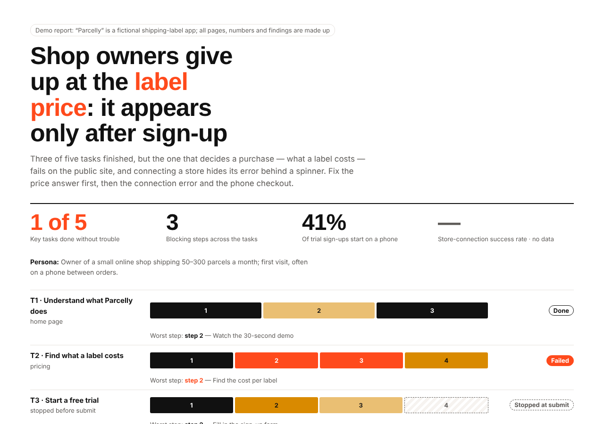
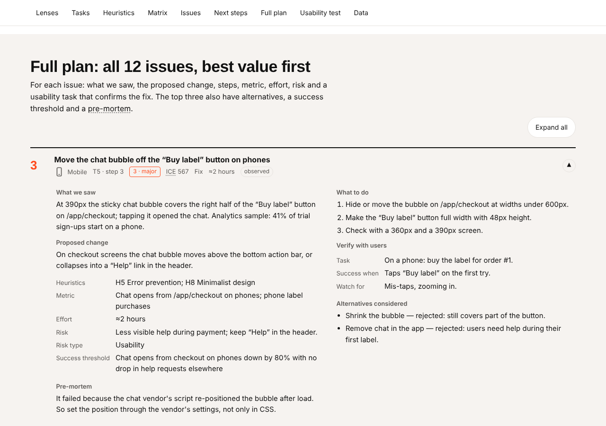
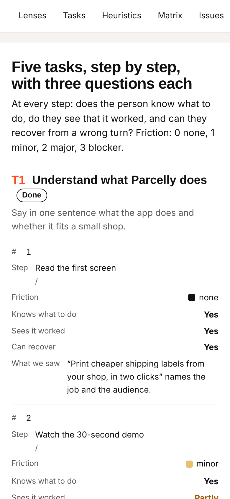

# UX Review

A Claude skill that walks the key tasks of a website, web app, SaaS flow or app screenshots **as your user**, step by step, and turns what breaks into a visual report, a prioritized fix list, a **5-task usability-test plan** and a **hands-off file** an AI agent can implement.

It answers one question: **can people find, understand, decide and act?** Visual polish belongs to a UI review; strategy, pricing models and growth belong to [product-lens-audit](https://github.com/artemhorbenko/product-lens-audit).

**Live demo:** [English](https://claude.ai/artifact/XFAybtaGhMsL5E9EEuadcA) (fictional shipping-label app "Parcelly", made-up data).



### The 10 UX lenses

| Group | Lens | The question it asks |
|---|---|---|
| Foundations | **Nielsen's 10 heuristics** | Which usability principles does each issue break (H1-H10)? |
| | **Key task walkthroughs** | At every step: does the person know what to do, see that it worked, and can they recover? |
| Find and understand | **Information architecture and navigation** | Can people predict where things live and get there? |
| | **Content clarity and microcopy** | Does the page say what it is, for whom, and what each button does? |
| Act and recover | **Forms and friction** | Is every field needed, labelled and autofill-ready? |
| | **Error and empty states** | Does every error and empty screen say what happened and what to do next? |
| Decide with confidence | **Trust and reassurance** | Is there a reason to believe at the moment of commitment? |
| | **Decision support** | Can people find a price, compare options and see what fits them? |
| Reach everyone | **Accessibility basics** | Keyboard, focus, labels, names, state — the basics that block tasks. |
| | **Mobile ergonomics** | Does the task work at 390px: tap targets, keypads, nothing covering the action? |

### Supporting methods

Cognitive walkthrough (know / see / recover), Nielsen's severity scale (1 cosmetic to 4 blocker), ICE prioritization, observed vs hypothesis labels, fix vs rethink, alternatives with a success threshold and a pre-mortem for the top 3, think-aloud usability testing with the Single Ease Question (SEQ).

## What you get

- **Tasks as the headline picture.** One row per key task, one square per step, coloured by friction, with the outcome (done, done with trouble, failed, stopped at submit) and the worst step named.
- **Walkthrough tables** for every task: friction and the three walkthrough answers per step, with what was seen.
- **Heuristics breakdown:** how many issues break each of Nielsen's 10 heuristics and how badly.
- **Issues ranked by ICE**, each with severity, task and step, heuristics, an observed/hypothesis badge, and fix or rethink; an impact-effort matrix.
- **A full plan for every issue:** what we saw, the proposed change, concrete steps, metric, effort, risk and a usability task that confirms the fix. The top 3 also get alternatives, a threshold, a pre-mortem and copy variants.
- **A 5-task usability-test plan** the team can run with real users: who to recruit, format, five goal-based tasks with start, success, what to watch and what to ask, and what to measure.
- **Honest confidence:** sources used and missing; unknown numbers show "no data".
- **Tooltips for every term** (ICE, SEQ, autocomplete, aria-expanded…): hover on desktop, tap on a phone. Tables stack on phones; dark theme; English and Ukrainian labels.

<p>


</p>

### Hands-off file for AI agents

`scripts/build_handoff.py` turns the same `audit.json` into `handoff.md` (+ optional `tasks.json`): context, persona, sources, rules for the implementer, then every issue as a task ordered by ICE with dependencies first — the user task and step, heuristics broken, evidence, proposed change, steps, acceptance criteria, a usability-test script to verify it, risks — and the 5-task test plan. Example: [`assets/example-handoff.en.md`](plugins/ux-review/skills/ux-review/assets/example-handoff.en.md).

## How it works

1. **Checks data sources** - browser, analytics, session recordings, accessibility scanner, support data - and marks each used, partial or missing.
2. **Asks up to 4 skippable questions**: who the user is, which tasks matter, what data you can share, what was tested before. Questions the request already answers are skipped.
3. **Walks every task live** in a browser at desktop and phone width, Tabs through the header and key flows, reads forms and hidden content from the page. **It never submits real forms**, payments or messages, and rejects non-essential cookies.
4. **Applies the 10 lenses**, tags heuristics, gives each issue a severity and an ICE score.
5. **Writes one `audit.json`**, validates it (`validate_audit.py`), builds the report (`build_report.py`) and the hands-off file (`build_handoff.py`), then **render-checks the report** on desktop, tablet and phone (`check_report.py`) and **fact-checks** every quote and number against the walk.

## Install

### Claude Code (terminal, desktop app, VS Code)

```
/plugin marketplace add artemhorbenko/ux-review
/plugin install ux-review@ux-review
```

Then ask, for example: *"UX review of example.com for a first-time buyer: find the price, compare plans, start a trial"*.

### Claude app (claude.ai, desktop, mobile)

1. Download `ux-review-skill.zip` from this repository ([direct download](https://github.com/artemhorbenko/ux-review/raw/main/ux-review-skill.zip)).
2. Make sure code execution is on (Settings → Capabilities).
3. Go to **Customize → Skills**, click **+**, then **Create skill → Upload a skill**, and choose the ZIP.

See Anthropic's guide: [Use skills in Claude](https://support.claude.com/en/articles/12512180-use-skills-in-claude).

### Any other agent that reads SKILL.md

Copy `plugins/ux-review/skills/ux-review/` into your agent's skills folder.

## Better results with data

The skill works with just a URL and a browser. Evidence makes severity sharper:

| Data | Options |
|---|---|
| Browser | Claude in Chrome, the built-in browser, a cloud browser, or Playwright |
| Behaviour | GA4, Mixpanel, PostHog; Microsoft Clarity or Hotjar for recordings and rage clicks |
| Accessibility | axe or Lighthouse in the shell |
| Questions people ask | Intercom, Zendesk, HubSpot - or paste the top pre-sale questions |
| Earlier tests | Maze, Lyssna, UserTesting notes |

## Build and check a report yourself

```
S=plugins/ux-review/skills/ux-review
python $S/scripts/validate_audit.py audit.json          # data and rules, standard library only
python $S/scripts/build_report.py audit.json report.html
python $S/scripts/build_handoff.py audit.json handoff.md --json tasks.json
pip install playwright && playwright install chromium   # or pass --browser /path/to/chrome
python $S/scripts/check_report.py report.html --out ./report-check
```

Start from `$S/assets/example-audit.en.json`; the shape is in `$S/references/audit.schema.json`.

## Privacy and safety

- Browsing is read-only: no form submissions, payments, messages, sign-ups or logins on the product under review.
- It never invents numbers, quotes, testimonials, prices or response times, and it does not recommend dark patterns.
- The report is one self-contained HTML file; nothing is sent anywhere by the report itself.

## Repository layout

```
.claude-plugin/marketplace.json        marketplace catalog (this repo)
plugins/ux-review/
  .claude-plugin/plugin.json
  skills/ux-review/
    SKILL.md                           the process
    references/lenses.md               the 10 lenses, heuristics, walkthrough, severity
    references/data-sources.md         browser, phone width, keyboard, analytics, scanners
    references/report-spec.md          report sections, tooltips, mobile rules
    references/audit.schema.json       shape of the report data
    assets/report-template.html        the report page; renders from one JSON block
    assets/example-audit.en.json       full example (fictional "Parcelly")
    assets/example-handoff.en.md       its hands-off file
    scripts/validate_audit.py          data and rule check
    scripts/build_report.py            audit.json -> report.html
    scripts/build_handoff.py           audit.json -> handoff.md (+ tasks.json)
    scripts/check_report.py            headless render check
evals/                                 scenarios, trigger prompts, results log
docs/                                  screenshots
ux-review-skill.zip                    the skill packaged for upload to the Claude app
```

## Credits

Ideas, not text: Jakob Nielsen's 10 usability heuristics and severity ratings (Nielsen Norman Group); the cognitive walkthrough (Wharton, Rieman, Lewis, Polson); the Single Ease Question (Sauro); think-aloud testing; WCAG for the accessibility basics. The report design and pipeline follow [product-lens-audit](https://github.com/artemhorbenko/product-lens-audit).

## License

MIT - see [LICENSE](LICENSE).

---

## Українською

**UX Review** - скіл для Claude, який проходить ключові задачі сайту чи застосунку **як ваш користувач**, крок за кроком, і перетворює те, що ламається, на візуальний звіт, пріоритизований список виправлень, **план юзабіліті-тесту на 5 задач** і **hands-off файл**, який може виконати AI-агент.

Він відповідає на одне питання: **чи можуть люди знайти, зрозуміти, вирішити й зробити?** Візуальне полірування - це UI-рев'ю, стратегія й ціноутворення - [product-lens-audit](https://github.com/artemhorbenko/product-lens-audit).

**Демо-звіт:** [англійською](https://claude.ai/artifact/XFAybtaGhMsL5E9EEuadcA) (вигаданий застосунок «Parcelly», умовні дані). Звіт має українські підписи: встановіть `"lang": "uk"` в audit.json.

**10 UX-лінз у 5 групах:**
- **Основа:** 10 евристик Нільсена (H1-H10), проходження ключових задач (когнітивний walkthrough: чи зрозуміло, що робити; чи видно, що спрацювало; чи можна виправити помилку).
- **Знайти й зрозуміти:** інформаційна архітектура й навігація, ясність контенту й мікрокопірайтинг.
- **Діяти й виправляти:** форми й тертя, стани помилок і порожні стани.
- **Вирішити впевнено:** довіра, підтримка рішення (ціна, порівняння).
- **Доступно всім:** базова доступність (клавіатура, фокус, підписи), мобільна ергономіка.

**Що в звіті:** задачі як рядки кроків, забарвлені за тертям; таблиці walkthrough; розбивка за евристиками; проблеми за ICE із серйозністю, задачею й кроком; повний план із запропонованою зміною та перевіркою з користувачами; план юзабіліті-тесту на 5 задач; джерела й впевненість. Окремо - `handoff.md` для AI-агента.

Встановлення в Claude Code:

```
/plugin marketplace add artemhorbenko/ux-review
/plugin install ux-review@ux-review
```

Для Claude app завантажте ZIP з репозиторію ([пряме завантаження](https://github.com/artemhorbenko/ux-review/raw/main/ux-review-skill.zip)), потім **Customize → Skills → + → Create skill → Upload a skill**.
